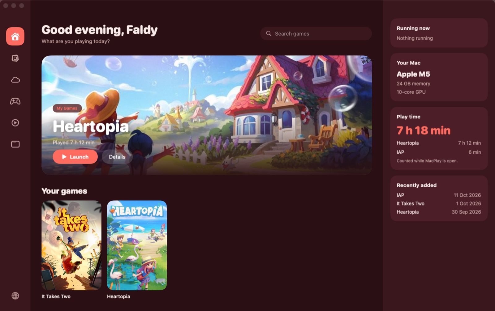
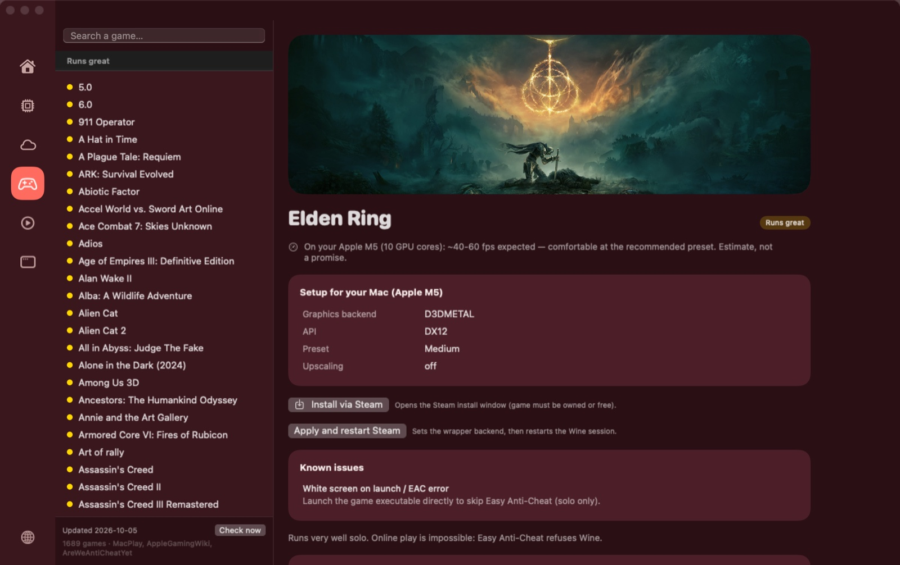
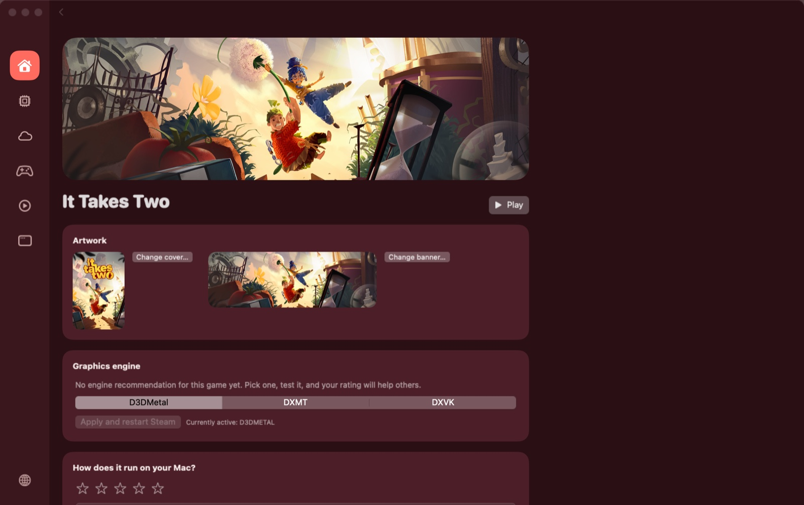
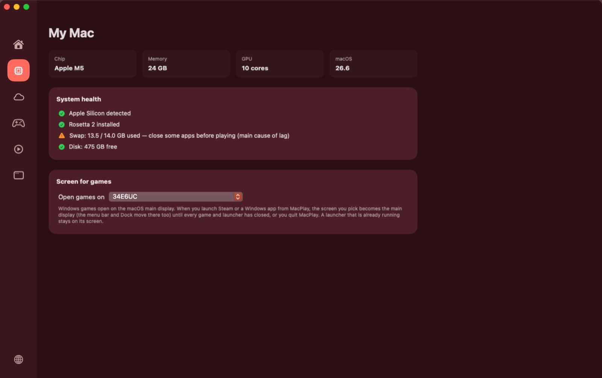

# MacPlay

**Play Windows games on your Mac — without touching a terminal.**

MacPlay is a small native macOS app for Apple Silicon that sets up and runs Windows games for
you: a game-launcher home for your library, one-click Windows Steam, any Windows game or app from
its installer, and advice tuned to your exact Mac.

> ⚠️ **Alpha.** This is an early build, shared to get feedback. Expect rough edges.
> Please [open an issue](../../issues) for anything broken, confusing, or missing.



## What you can do

The rail on the left holds the sections: **Home**, **My Mac**, **Steam**, **Compatible Games**,
**My Games** and **My Apps** (hover an icon to see its name). The globe at the bottom switches the
language between English, French and Indonesian; by default MacPlay follows your Mac's.

### Home

- The game you played last in a big banner, with **Play** for Steam games and **Launch** for the
  rest.
- **Your games**: your installed Steam games and everything in My Games, as covers.
- **Runs great on your Mac**: games MacPlay has tuned by hand and that run well, to find what to
  play next.
- Search across your games, your programs and the whole compatibility list.
- Cards for what's running, your Mac, the time you've played and the games you installed recently;
  programs in My Apps count for neither. Play time is counted while MacPlay is open and stays on
  this Mac.
- Covers and banners come from Steam. For a game without any (Heartopia installed through TapTap,
  for example), **Choose a cover** opens Google Images in your browser: drag the image you like
  back into MacPlay, paste it, or pick a file. Change or reset it later on the game's page, or by
  right-clicking its cover or the banner.

### Compatible Games



- About 1,700 Windows games and how well they run: 80 tuned by hand by MacPlay (graphics engine,
  presets and fixes, from Elden Ring to The Witcher 3) and some 1,600 more rated from
  [AppleGamingWiki](https://www.applegamingwiki.com) reports (CrossOver or Wine), each with the
  date of its latest report.
- Games whose kernel anti-cheat refuses Wine (Fortnite, Valorant, Destiny 2…) are marked as
  blocked, from [AreWeAntiCheatYet](https://areweanticheatyet.com), instead of wasting your
  evening.
- For each game: an honest fps estimate for your chip, the recommended setup (graphics engine,
  DirectX version, preset, upscaling), known issues, **Install via Steam**, and **Apply and restart
  Steam** to switch to the recommended engine.
- The list is rebuilt every Monday, and MacPlay picks up the new one at most once a day.

### Steam



- **Install Steam** downloads and assembles Windows Steam with Wine, the fonts it needs and known
  workarounds: about 450 MB and 10–15 minutes, fully automatic.
- **Launch**, **Stop**, **Restart Steam cleanly** (after a Steam update misbehaves), reinstall or
  uninstall.
- Your installed Steam games, each with its own page: **Play**, the graphics engine (D3DMetal,
  DXMT, DXVK), its cover and banner, and a 1–5★ rating. Ratings are sent anonymously *with your
  hardware profile and the engine used*, so "runs great" actually means something.
- MacPlay starts Steam with your game and watches the session: if the game crashes right away, it
  suggests trying another engine.

### My Games and My Apps

- Install any Windows game, game launcher (TapTap, Battle.net…) or program from its setup `.exe` or
  its Windows Installer package (`.msi`). Games and launchers go in **My Games**, everything else in
  **My Apps**; you can move them between the two later.
- Each gets its own wrapper (about 1.2 GB before the program itself) with the Windows core fonts;
  without them, some games draw blank text. MacPlay runs the installer, finds the program it
  installed (a windowed one rather than a command-line tool) and launches it with the graphics
  engine you pick.
- Stop, rename, pick another program or add launch options, or uninstall at any time. Games a
  launcher installs live in its wrapper and use its engine.

### My Mac



- Your chip, memory, GPU cores and macOS version; MacPlay's advice is tuned to them.
- Health checks: Apple Silicon, Rosetta 2, swap use (the main cause of lag) and free disk space.
- **Screen for games**: with an external display connected, choose the screen games open on. Wine
  opens games on the macOS main display, so MacPlay makes your choice the main display while games
  run, then puts your arrangement back.

## Install

**Requirements:** Apple Silicon (M1 or later), macOS 14.6+ (what the Sikarugir wrapper
template requires).

1. Download **MacPlay-x.y.z.dmg** from the [latest release](../../releases/latest).
   To check the download, put the `.sha256` file next to it and run
   `shasum -a 256 -c MacPlay-x.y.z.dmg.sha256`.
2. Open the dmg, drag MacPlay to Applications.
3. First launch: macOS will refuse to open it (this build isn't notarized — that
   requires a paid Apple Developer account). Click **Done** (not "Move to Trash"),
   then go to **System Settings → Privacy & Security → Open Anyway**. One time only.

## Getting started

1. **My Mac**: check the health list (Apple Silicon, Rosetta 2, swap, disk space).
2. **Steam** → **Install Steam**. When it's done, **Launch** it, sign in and install games as
   usual, or use **Install via Steam** on a game in Compatible Games.
3. For a game or launcher outside Steam: **My Games** → **Install a Windows game…**, then pick its
   `.exe` or `.msi`.
4. Back on **Home**, press **Play** or **Launch**.

## Standing on the shoulders of giants

MacPlay is a friendly front-end. **All the hard parts come from other projects:**

- **[Sikarugir](https://github.com/Sikarugir-App/Sikarugir)** — the Wine wrapper stack
  MacPlay installs and drives (a continuation of the Wineskin/Kegworks lineage by
  [@Gcenx](https://github.com/Gcenx)). MacPlay downloads the official Sikarugir wrapper,
  engines and winetricks at setup time; none of their binaries are redistributed here.
- **[Wine](https://www.winehq.org/)** — the Windows compatibility layer itself.
- **D3DMetal** (Apple's Game Porting Toolkit), **[DXVK](https://github.com/doitsujin/dxvk)**
  and **[DXMT](https://github.com/3Shain/dxmt)** — the DirectX → Metal/Vulkan translation
  that makes games actually run.

MacPlay is not affiliated with any of these projects, with Valve, or with Apple.
If you find MacPlay useful, those projects deserve your stars first.

## What it touches (security)

Fair question for any app, doubly so for an alpha you found on Reddit. Short version:
**no admin password, no root, no sandbox escape into your data.** Everything is in the
open — read [`app/Sources/MacPlay/Engine.swift`](app/Sources/MacPlay/Engine.swift) and
[`app/Sources/MacPlay/WindowsApps.swift`](app/Sources/MacPlay/WindowsApps.swift), they're
the whole story.

What MacPlay **does**:

- **Writes only to folders you already own** — `~/Applications/Sikarugir/` (the Steam
  wrapper, plus one wrapper per Windows program you install), `~/Library/Caches/macplay`
  + `~/.cache/winetricks` (downloads, installer logs, game artwork), and
  `~/Library/Application Support/MacPlay` (covers you choose). It never writes to `/System`,
  `/Library`, or anywhere privileged.
- **Runs the Windows installers you pick** (a setup `.exe`, or an `.msi` through Wine's
  Windows Installer, which also leaves its detailed log in `~/Library/Caches/macplay`) inside that
  program's own wrapper. What the installer then does is up to the installer, as on Windows.
- **Downloads and runs third-party components at setup** — the Sikarugir wrapper, Wine
  engines, winetricks and Steam's installer, from GitHub, `raw.githubusercontent.com` and
  Steam's CDN; winetricks then fetches Microsoft's core fonts from GitHub. This is the same
  thing every Wine wrapper (Sikarugir, Whisky, CrossOver) does; it's how Windows games run
  on a Mac at all. The wrapper, engine and winetricks are pinned to exact versions and
  checked against their SHA-256 before use (winetricks checks the fonts the same way).
  Steam's installer is the exception: Valve only serves the latest one.
- **Runs standard system binaries**: `curl`, `tar`, `xattr`, `open`, `sysctl`,
  `system_profiler`, `pgrep`, `ps` (play time), and `sh` to run winetricks, plus the bundled `wine`.
- **Removes the quarantine flag** (`xattr -dr com.apple.quarantine`) from the wrappers it
  builds, so Wine can launch — this is a deliberate, scoped Gatekeeper bypass on
  MacPlay's own files only.
- **Rearranges your displays, only if you pick a screen for games** — the chosen screen
  becomes the main display (menu bar and Dock included) when you launch from MacPlay. The
  change is app-scoped: it is undone when every game and launcher has closed, and macOS undoes
  it by itself if MacPlay quits.
- **Downloads the compatibility list** — at most once a day, from this repository on
  `raw.githubusercontent.com`, into `~/Library/Caches/macplay`. It is plain data (ratings,
  notes, links); a broken or emptied list is ignored and the built-in one is used.
- **Downloads game artwork** — cover and banner images by Steam app id from Steam's image
  server, `cdn.akamai.steamstatic.com`, cached in `~/Library/Caches/macplay/art`. The request
  tells Steam's server which games' images are shown; nothing else is sent. An image Steam
  doesn't have is asked for again after 7 days. MacPlay never reads Google's results itself: *Search
  Google Images* only opens your browser. If you drop or paste a *link* to an image, MacPlay
  downloads that one file over HTTPS from the site it points to; anything that isn't an image is
  refused, and what is kept is re-encoded to a plain JPEG.
- **Counts play time locally** — every 30 seconds while MacPlay is open it lists running
  processes to see which games are up (Steam games and My Games; programs in My Apps aren't
  counted), and keeps the totals in its own preferences. Never sent anywhere.
- **Sends anonymous ratings** — when you rate a game, the score plus your hardware profile
  (chip, RAM, macOS, engine used) is POSTed to the ratings backend. No account, no personal
  data, and only when you click "Send".

What it **never** does: ask for your password, request root, read your files/keychain/other
apps, or install a background service or launch agent.

Because it's open source, none of this is "trust me" — it's `grep`-able.

## For developers

```bash
cd app
./build.sh          # → dist/MacPlay.app (SwiftUI via SPM, no Xcode project needed)
```

The app icon comes from `icon/AppIcon-source.png`: `swift icon/make-icon.swift` (from `app/`)
cuts the tile out of it and regenerates `icon/AppIcon.icns`.

The repo also contains the original Python prototype of the engine
(`macplay.py`, dev tool only) and the hand-maintained games list (`data/games.json`).

`data/compatibility.json` is generated: `tools/update_compat.py` merges `data/games.json`
with AppleGamingWiki and AreWeAntiCheatYet, and the *Update compatibility list* workflow
runs it every Monday and commits the result. Don't edit it by hand. To refresh it locally:
`python3 tools/update_compat.py` (standard library only).

Tests: `swift test` (from `app/`) and `python3 -m unittest discover -s tools/tests`. The *CI*
workflow runs them, a release build and a [Trivy](https://trivy.dev) scan (vulnerabilities,
secrets, misconfigurations; high or critical findings fail it) on every push and pull request.
Dependabot keeps the pinned GitHub Actions current, waiting 7 days after each release.

### Releases

Releases are manual: **Actions → Release → Run workflow**, type `release`, run. Anything else
only builds the DMG and keeps it as a test artifact for 7 days. The version follows
[Semantic Versioning](https://semver.org) from the [Conventional Commits](https://www.conventionalcommits.org)
since the last tag (`tools/next_version.py`): a breaking change (`feat!:` or a
`BREAKING CHANGE:` footer) bumps the major version, `feat` the minor, `fix`/`perf`/`revert` the
patch; other types release nothing. The release notes list those commits, and the DMG comes
with its SHA-256. Locally, `./build.sh && ./make_dmg.sh <version>` (from `app/`) makes the same DMG.

Specs for new work use [GitHub Spec Kit](https://github.com/github/spec-kit): project
scaffolding lives in `.specify/`, and the `/speckit-*` Claude Code skills in `.claude/skills/`.

## Contributing / feedback

This alpha exists to collect feedback:

- 🐛 **Something broke?** Open an issue with your chip (e.g. M2 Pro), macOS version,
  the game, and what happened.
- 🎮 **A game is missing or misrated?** Issues and PRs against `data/games.json`
  are very welcome — that hand-tuned list is the heart of the project. Community ratings
  come from AppleGamingWiki: adding your report there improves MacPlay too.
- 💡 **Ideas** on making this simpler for non-technical users are the most valuable
  thing you can send.

## Known limitations (alpha)

- **Steam is the only launcher MacPlay knows inside out** (game database, install and
  launch by game, crash watch, ratings). Other launchers install fine from their `.exe` or `.msi`
  under *My Games*, but MacPlay doesn't see the games inside them: launch those from
  the launcher itself. Whether a given launcher runs under Wine at all is up to Wine.
- Steam's self-updates can be capricious under Wine — if Steam hangs or misbehaves
  after an update, use **"Restart Steam cleanly"** in MacPlay's Steam section; that
  resolves most of it.
- Not notarized → the one-time Gatekeeper dance described above.
- Launching a game restarts Steam if it was already open (Wine can't forward commands
  to a running Steam instance).
- One engine per wrapper: all Steam games share Steam's engine choice, and each Windows
  app's games share that app's.
- New wrappers run Sikarugir's Wine 11 engine, which fixes mouse and keyboard going dead
  after switching back to a game (Cmd+Tab or the Dock). Its template offers D3DMetal, DXMT
  and DXVK; WineD3D is gone. Wrappers built by earlier MacPlay versions keep their Wine 10
  engine and all four choices.
- Kernel-anticheat multiplayer games will never work through translation.
- .NET programs run on Wine Mono, Wine's own replacement for .NET, which comes with the engine;
  whether a given program works is up to it. New program wrappers stand Tahoma in for Segoe UI,
  the Windows interface font many of them ask for, which can't be redistributed.
- Play time only counts while MacPlay is open, and a game started inside a launcher
  (Heartopia in TapTap) counts for the launcher.
- Imported ratings are only as good as the reports behind them. Many AppleGamingWiki
  reports are from 2021-2022, before D3DMetal existed, so check the date shown next to each.
  Imported games have no engine recommendation, and anti-cheat blocks are based on
  Linux/Proton data.
- GitHub turns off scheduled workflows in public repositories after 60 days without
  activity; if the list stops updating, re-enable the workflow in the Actions tab.

## License

[MIT](LICENSE) — for MacPlay's own code and hand-maintained data (`data/games.json`).

`data/compatibility.json` contains content from [AppleGamingWiki](https://www.applegamingwiki.com),
so it is licensed [CC BY-NC-SA 3.0](https://creativecommons.org/licenses/by-nc-sa/3.0/):
credit AppleGamingWiki, no commercial use, share alike. It also includes data from
[AreWeAntiCheatYet](https://github.com/AreWeAntiCheatYet/AreWeAntiCheatYet) (MIT).

The components MacPlay downloads at setup time (Sikarugir wrapper, Wine engines,
winetricks, D3DMetal) belong to their respective projects under their own licenses.
